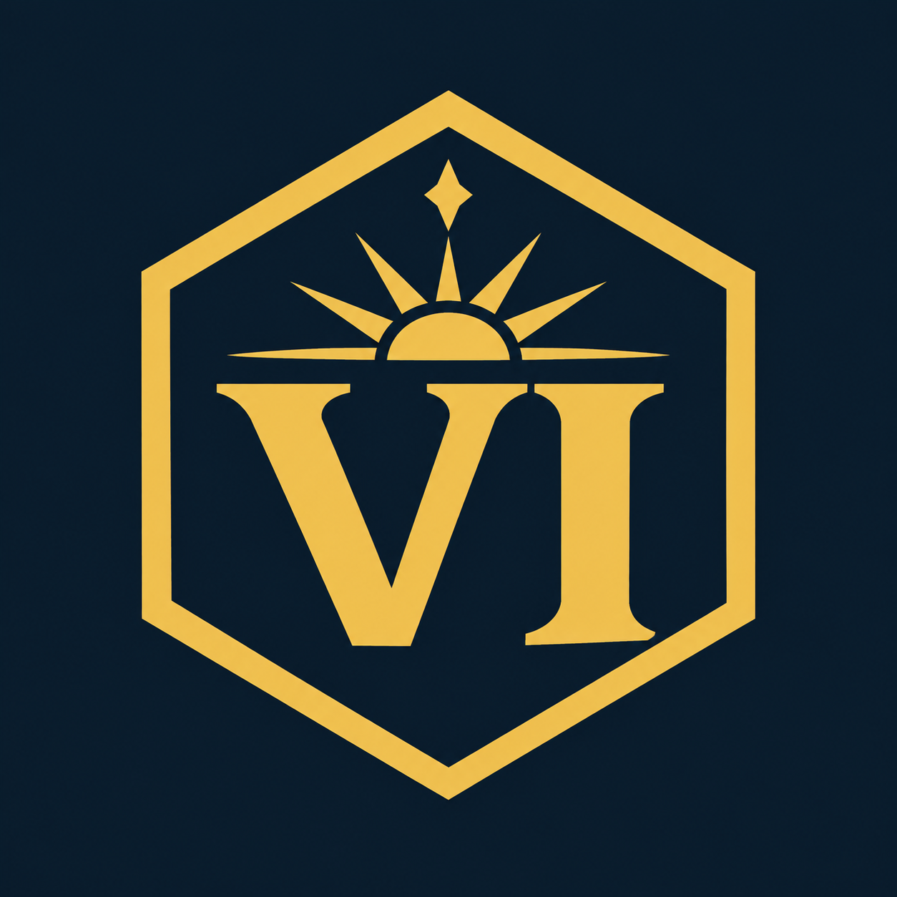

# Civ VI Mods

### Independent Civilization VI mods

**A little more possibility. One more turn.**

[简体中文](https://github.com/civs6-mods/.github/blob/main/profile/README.zh-CN.md) · **English**

BridgeSpan: build your own bridges and connect the shores in Civilization VI.

[Browse repositories](https://github.com/orgs/civs6-mods/repositories) · [BridgeSpan](https://github.com/civs6-mods/BridgeSpan) · [Steam Workshop](https://steamcommunity.com/sharedfiles/filedetails/?id=3838759919&l=english)

---

## Current projects

### BridgeSpan — Build Your Own Bridges

Build bridges across coast and lake tiles to connect the shores. Land units and traders cross the bridge, while ships can still pass through its water tiles.

- One-tile stone bridges and two-/three-tile sea bridges, built through city production. A city can build multiple bridges.
- Preview and choose between valid layouts, with bridge tiles and A/B shores highlighted.
- Supports the Windows Steam edition of Civilization VI, Gathering Storm, single-player, including Harmony in Diversity.
- **v41 is publicly available.** Subscribe and enable it in Additional Content; no external launcher is needed. Stone bridges require Engineering in the standard technology tree, or Arch with Harmony in Diversity. Sea bridges require Steel, and both types also require Shipbuilding.

[English README](https://github.com/civs6-mods/BridgeSpan#readme) · [中文说明](https://github.com/civs6-mods/BridgeSpan/blob/main/README.zh-CN.md) · [Subscribe on Steam](https://steamcommunity.com/sharedfiles/filedetails/?id=3838759919&l=english) · [Source & issues](https://github.com/civs6-mods/BridgeSpan)

Check the project README for installation requirements, gameplay limitations and verification scope.

## Feedback & contributions

- **Play:** read the project's installation instructions, dependencies and verified scope.
- **Report issues:** use the project's Issues and include the game version, ruleset, screenshots, reproduction steps and enabled mods. A save from before the issue is especially helpful.
- **Contribute:** pull requests for translations, testing, Lua / UI development, and bridge models or art are welcome, as are feature suggestions. Explain the purpose of each change and its verification results.

BridgeSpan code is MIT licensed; third-party dependencies retain their own licenses and attribution.

An independent player project, not affiliated with Firaxis Games, 2K or the official Civilization team. Civilization and related trademarks belong to their respective owners.
